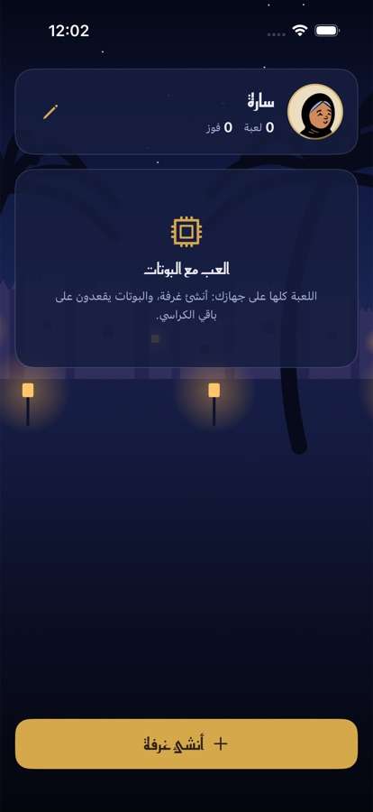
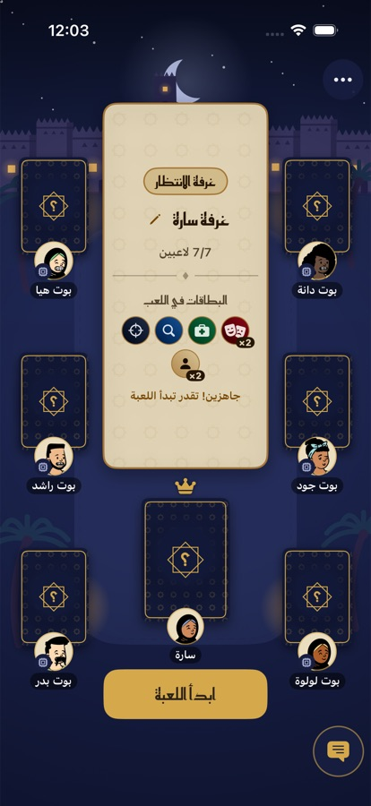
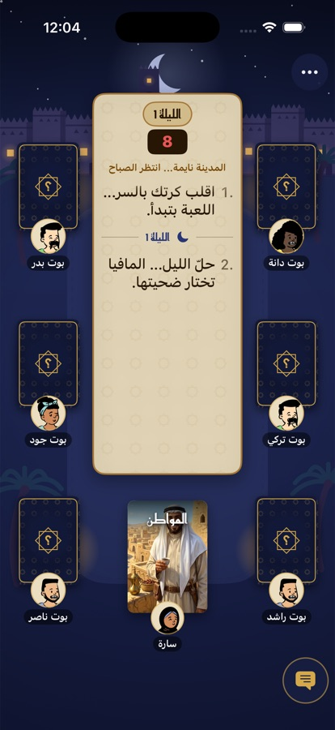
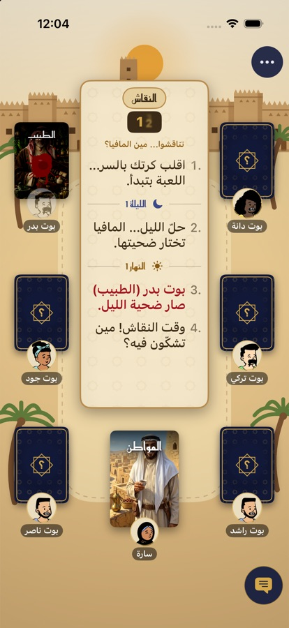

# Mafia (المافيا) — iOS

An Arabic social-deduction game for iPhone and iPad, built with SwiftUI. You sit at a table with up to eight bots. Each player gets a secret role. At night the mafia picks a victim while the town's special roles act. By day everyone argues, votes, and puts one suspect on trial.

This edition runs **entirely on the device**: no account, no network, no server. The online version of the app uses the same UI against a game server. Here a local engine plays that part, so every screen works unchanged.

<p align="center">
  
  
  
  
</p>

## Getting started

Requirements: Xcode 16 or later (Swift 6), iOS 17 or later, and [XcodeGen](https://github.com/yonaskolb/XcodeGen).

```sh
brew install xcodegen
xcodegen            # generates MafiaGame.xcodeproj from project.yml
open MafiaGame.xcodeproj
```

Choose an iPhone simulator and run. Simulator builds need no signing. To run on a real device, set your team under *Signing & Capabilities* and change `PRODUCT_BUNDLE_IDENTIFIER` in `project.yml`.

## How a game goes

1. **Role reveal**: each player secretly flips their card.
2. **Night**: the mafia choose a victim together, the doctor protects someone, the detective inspects a card, and the officer may fire their one bullet.
3. **Morning**: the narrator announces who died. A dead player's card is turned face up.
4. **Discussion**: talk it out in the chat. The mayor may reveal their card here.
5. **Voting**: the player with the most votes goes on trial. Nobody does if the vote ties or abstentions match the leader.
6. **Defense and judgment**: the accused pleads their case, and everyone else votes to eliminate or pardon. A tied judgment spares the accused.
7. Repeat until a team wins. The town wins once every mafia member is out. The mafia win once they equal or outnumber the town. After 15 rounds the game is a draw.

| Role | Team | Ability |
|---|---|---|
| Mafia (المافيا) | Mafia | Votes with teammates on a victim each night; sees teammates' picks live. |
| Doctor (الطبيب) | Town | Protects one player a night; may protect themself, but never the same player two nights running. |
| Detective (المحقق) | Town | Flips one player's card each night (final choice); never the same player twice. |
| Officer (الضابط) | Town | One bullet per game: a mafia target dies, an innocent target means the officer dies instead. The doctor can't stop it. |
| Mayor (العمدة) | Town | May reveal their card by day; from then on their vote counts three times. |
| Citizen (المواطن) | Town | No ability: talk, watch, and vote. |

The deck follows the player count (5–9), and the room's leader can adjust the number of mafia and switch the optional roles on or off.

## Architecture

```
MafiaGame/
├── App/            entry point, root view, preview data
├── Models/         Protocol.swift: the messages between the app and the narrator
├── Services/       GameService protocol, identity storage, MockGameService for tests
├── Stores/         GameStore: holds the latest snapshots, turns taps into messages
├── ViewModels/     one per screen, all plain @Observable classes
├── Views/, Components/, Theme/   SwiftUI
└── Local/          the on-device game engine
    ├── Rules/          pure rules: roles, dealing, night resolution, votes, win check, narration
    ├── LocalRoom.swift             the phase state machine and timers
    ├── LocalRoom+Snapshots.swift   what each player is allowed to see
    ├── Bots.swift                  the other players
    └── LocalGameService.swift      plugs the engine into the app
```

The UI never computes game results. `GameStore` sends `ClientMessage`s through a `GameService` and renders the `ServerMessage`s it gets back. `LocalGameService` implements that protocol in memory: it runs a `LocalRoom` and answers with the same `state`, `chat` and `error` messages a server would send. Swapping it for a WebSocket client is all an online build needs.

**Secrecy.** `LocalRoom+Snapshots.swift` is the only place that builds what the app sees. Every player gets a public room snapshot plus a private one of their own. Roles, teammates and inspection results appear only in the private part, and only for the player entitled to them. This holds even though everything runs in one process.

**Bots.** They are simple on purpose. They make random but valid choices, nudged by what their role knows: the mafia never vote out a teammate, and the detective votes against a mafia member they've found.

**Dev tools.** Open the room settings (⋯) and choose *أدوات التطوير*. From there you can add bots, pick your own role for the next game, or switch to fast timers.

## Tests

```sh
xcodebuild test -project MafiaGame.xcodeproj -scheme MafiaGame \
  -destination 'platform=iOS Simulator,name=iPhone 17 Pro'
```

The suite covers the rules (dealing, night resolution, voting, win conditions) and the store and view models. It also plays several complete seeded games between bots and checks that no living player's role ever leaks.

## Adding a role

1. Add a `RoleDefinition` to `RoleCatalog.all` in `Local/Rules/Roles.swift`, with a name, team, night ability and deal count.
2. If its night ability is a new kind, add an `AbilityKind` in `Models/Protocol.swift` and resolve it in `Night.resolve`.
3. Give it a card style in `Components/RoleStyle.swift` and, optionally, art in `Resources/Art/`.

## License

The source code is released under the [MIT License](LICENSE).

The artwork (role cards, avatars, app icon) is **not** covered by that license. All rights to it are reserved, so don't reuse it in your own apps. The Reem Kufi font is © its authors under the [SIL Open Font License](MafiaGame/Resources/Fonts/OFL.txt).
